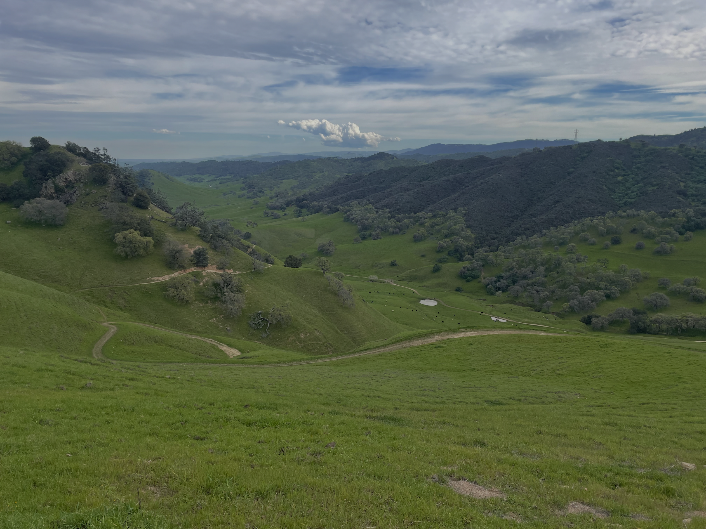
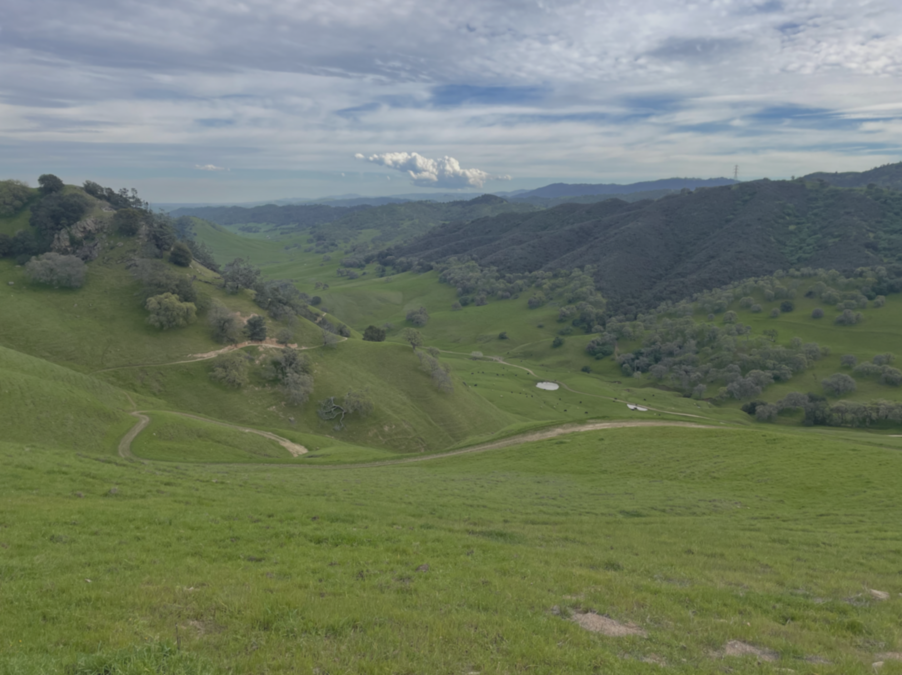

Parhelion is an early-stage C++ image-processing library with NEON/SME2 CPU kernels,
threaded pointwise operations, and Metal pointwise kernels on macOS.

## build and test

Requires CMake 3.21+, a C++20 compiler with SME2 ACLE intrinsics and streaming attributes,
and an AArch64 target. Running the kernels requires SME2 hardware and operating-system
support for streaming mode. There is no runtime fallback.

```sh
cmake --preset release
cmake --build --preset release --parallel
ctest --preset release
```

The library is `build/release/libparhelion.a`. Public kernel headers are
`parhelion-1.hpp` and `parhelion-2.hpp`; layout conversion and image i/o have separate
headers in `include/`.

The default architecture flag is `-march=armv8-a+sme2`.

## single-threaded pipeline

Load a PNG, brighten it, apply Gaussian blur, and save the result.

```cpp
#include "AoS_SoA.hpp"
#include "image_load.hpp"
#include "image_write.hpp"
#include "parhelion-1.hpp"
#include "parhelion-2.hpp"

int main() {
    auto input = image_load("examples/black-diamond-before.png");
    convert_to_planar(input);
    brighten(input.view_mut(), 20);

    Frame output(input.get_width(), input.get_height(), input.get_pixel_format(),
        FrameLayout::Planar, std::vector<std::byte>(input.view_ref().get_span().size()));
    gaussian_blur(input.view_ref(), output.view_mut(), 1.5f, 4);

    convert_to_interleaved(output);
    image_write("examples/black-diamond-after.png", output);
}
```

| Before | After |
| --- | --- |
|  |  |

| Parhelion | OpenCV | vImage |
| ---: | ---: | ---: |
| 26.016 ms | 38.641 ms | 33.175 ms |

Median of 31 single-threaded runs on an Apple M4 using the pictured 2524 × 1892 RGBA image.
Timings include allocations and layout conversions and exclude PNG I/O. The benchmark
preserves the source image, so Parhelion also copies the input before processing.

## threading and metal

Include `parallel-parhelion-1.hpp` to run pointwise operations with a reusable pool:

```cpp
ThreadPool pool(8);
parallel_brighten(pool, frame.view_mut(), 20);
```

The wrappers internally choose how many tasks to submit and run small jobs on the caller.

On macOS, include `metal-parhelion-1.hpp` to use a reusable Metal context:

```cpp
MetalContext gpu;
MetalFrame image(gpu, 1920, 1080, PixelFormat::RGBA, FrameLayout::Planar);
fill(image.view_mut(), Color::RGBA{std::byte{40}, std::byte{80}, std::byte{120}, std::byte{255}});
metal_brighten(gpu, image, 20);
```

CPU views and Metal share the image's storage. Metal calls wait for completion before
returning. Passing an ordinary `FrameView` to Metal uses staging copies.

## benchmarks

Benchmarks are optional and are not run by CTest. OpenCV comparisons require an
existing OpenCV build with `core` and `imgproc`. The bundled build is found automatically;
otherwise pass `-DOpenCV_DIR=/path/to/opencv/config` when configuring.

```sh
sh third_party/build_opencv.sh
cmake --preset benchmarks
cmake --build --preset benchmarks --parallel
./build/benchmarks/benchmarks/parhelion_bench_scale_opencv
```

The [pipeline benchmark](benchmarks/pipeline/readme.md) measures interleaved conversion,
brightness, Gaussian blur, and conversion back, including allocations and stage timings:

```sh
./build/benchmarks/benchmarks/parhelion_bench_pipeline
# shorter correctness and timing run
./build/benchmarks/benchmarks/parhelion_bench_pipeline --quick
```

Apple builds also enable Accelerate/vImage comparisons. Disable either backend with
`-DPARHELION_BENCHMARK_OPENCV=OFF` or `-DPARHELION_BENCHMARK_VIMAGE=OFF`.

See [threading](benchmarks/threading) and [Metal](benchmarks/metal) for per-kernel
comparisons. Run `./build/benchmarks/benchmarks/parhelion_bench_metal_shared` to compare
serial CPU, threaded CPU, staged Metal, and shared Metal.
